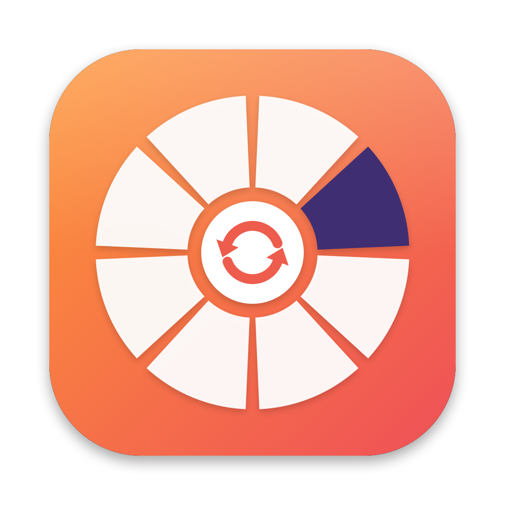
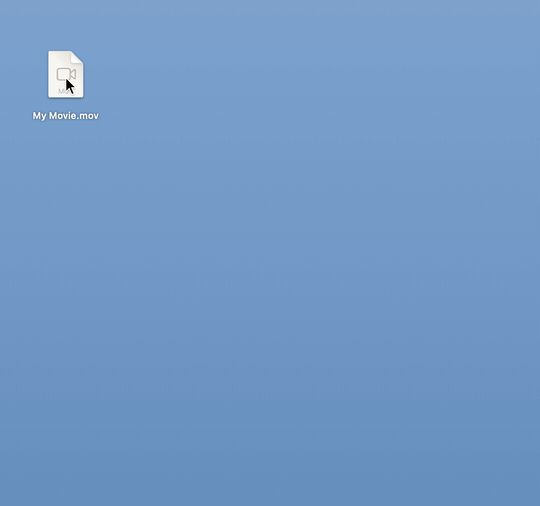
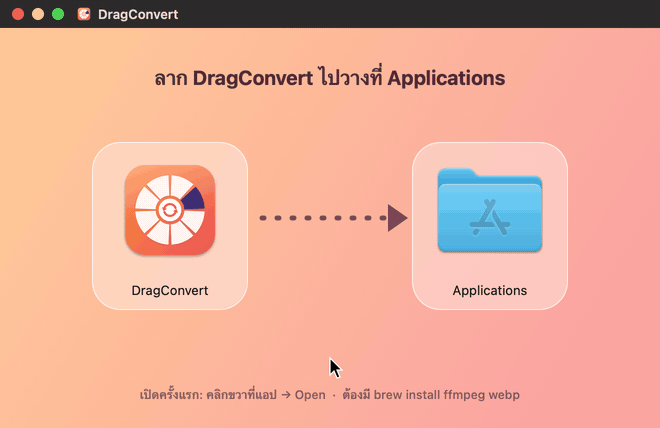

<div align="center">



# DragConvert

**แปลงไฟล์บน Mac แค่ลาก + กด Shift**

ลากไฟล์ใน Finder แล้วกด <kbd>⇧ Shift</kbd> วงล้อฟอร์แมตจะโผล่รอบเมาส์<br>
ปล่อยบนช่องที่ต้องการ ไฟล์ใหม่จะไปอยู่ข้างไฟล์เดิมทันที

ฟรี · ไม่จำกัดจำนวน · ทำงานในเครื่อง ไม่อัปโหลดไฟล์ไปไหน

[**⬇︎ ดาวน์โหลด DMG**](../../releases/latest) &nbsp;·&nbsp; macOS 13+ · Apple silicon

<br>



</div>

---

## ✨ จุดเด่น

- **ไม่ต้องเปิดแอป** — แปลงจาก Finder ได้เลย ไม่ต้อง import / เลือกโฟลเดอร์ / export
- **วงล้อขยายแบบ Dock** — ช่องที่ชี้จะใหญ่ขึ้น ช่องข้าง ๆ ขยายตามลดหลั่น มีป้ายชื่อเด้งขึ้นมา
- **เห็นเฉพาะฟอร์แมตที่แปลงได้** — ลากวิดีโอก็เห็นแต่ตัวเลือกวิดีโอ ลากรูปก็เห็นแต่ตัวเลือกรูป
- **หลายไฟล์พร้อมกัน** — เลือกหลายไฟล์ประเภทเดียวกันแล้วลากทีเดียว
- **อยู่บน Menu Bar เงียบ ๆ** — ไม่มีไอคอนใน Dock ไอคอนวงล้อหมุนตอนกำลังแปลง
- **ไม่ต้องให้สิทธิ์ Accessibility** — ไม่ได้ดักคีย์บอร์ดทั้งระบบ

## 📦 ติดตั้ง



1. ดาวน์โหลด `DragConvert-x.x.dmg` จากหน้า [Releases](../../releases/latest) แล้วดับเบิลคลิก
2. ลาก **DragConvert** ไปวางที่ **Applications**
3. ติดตั้งตัวแปลงที่แอปเรียกใช้ (ครั้งเดียว)
   ```bash
   brew install ffmpeg webp
   ```
4. เปิดแอปครั้งแรก: **คลิกขวาที่แอป → Open → Open**
   (แอปไม่ได้เซ็นกับ Apple ถ้ายังเปิดไม่ได้ ให้รัน `xattr -dr com.apple.quarantine /Applications/DragConvert.app`)
5. กด **Allow** ตอน macOS ถามสิทธิ์ Desktop, Documents และ Downloads

> เช็กสิทธิ์ได้ทุกเมื่อจากไอคอนวงล้อบน Menu Bar → **ตรวจสอบสิทธิ์เข้าถึงไฟล์…**
> หรือ System Settings → Privacy & Security → Files and Folders → DragConvert

## 🖱 วิธีใช้

| | |
|---|---|
| 1 | คลิกค้างที่ไฟล์ใน Finder แล้วเริ่มลาก |
| 2 | กด <kbd>⇧ Shift</kbd> ค้างไว้ → วงล้อโผล่รอบเมาส์ |
| 3 | ลากไปทับช่องที่ต้องการ (ช่องจะขยายขึ้น) แล้วปล่อย |
| 4 | ได้ยินเสียง "ติ๊ง" แล้ว Finder จะเลือกไฟล์ใหม่ให้ดู |

ปล่อยตรงวงกลมกลาง = ยกเลิก · ดูหน้าตาวงล้อได้จาก Menu Bar → **ดูตัวอย่างวงล้อ** (<kbd>⌘P</kbd>)

## 🎛 ฟอร์แมตที่รองรับ

| ไฟล์ต้นทาง | แปลงเป็น | ใช้ |
|---|---|---|
| 🎬 **วิดีโอ** — MOV, MP4, MKV, AVI, … | MP4 (H.264) · MP4 720p · บีบอัด · MOV · GIF · MP3 · M4A · ตัดเสียง · ดึงซับ SRT · ภาพปก JPG | ffmpeg |
| 🎵 **เสียง** — MP3, WAV, M4A, FLAC, … | MP3 320k · M4A · WAV · FLAC · AIFF | ffmpeg |
| 🖼 **รูป** — JPG, PNG, HEIC, TIFF, … | JPG · PNG · HEIC · WebP · TIFF · PDF · ย่อ 1920px / 1080px | sips, cwebp |
| 📄 **PDF** | PNG / JPG ทุกหน้า · ข้อความ TXT | PDFKit |

ชื่อไฟล์ไม่ทับของเดิม — ถ้ามีชื่อซ้ำจะเป็น `clip 2.mp4`, `clip 3.mp4`, …

## 🛠 Build เอง

ต้องมี Xcode หรือ Command Line Tools (Swift 5.9+)

```bash
git clone https://github.com/<username>/DragConvert.git
cd DragConvert
./build.sh          # build + ติดตั้งลง /Applications
./make_dmg.sh       # สร้างไฟล์ติดตั้ง dist/DragConvert-1.0.dmg
```

**เปิดใน Xcode:** `open Package.swift` → Product → Scheme → Edit Scheme… → Run → Arguments → เพิ่ม `--preview` แล้วกด <kbd>⌘R</kbd> วงล้อจะขึ้นกลางจอทันที

**ทดสอบแปลงโดยไม่ต้องลาก:**
```bash
/Applications/DragConvert.app/Contents/MacOS/DragConvert --convert ~/Desktop/clip.mov MP4 720p
```

### เพิ่มฟอร์แมตเอง

เพิ่มบรรทัดใน `Sources/DragConvert/Formats.swift` เช่น วิดีโอ 1080p

```swift
FormatOption("MP4", "1080p", ext: "mp4", suffix: "-1080p",
             .ffmpeg(["-vf", "scale=-2:1080"] + h264)),
```

### โครงสร้าง

```
Sources/DragConvert/
├── App.swift            เริ่มแอป + เมนูบน Menu Bar
├── DragMonitor.swift    ตรวจว่ากำลังลากไฟล์ + กด Shift (ไม่ต้องใช้สิทธิ์ Accessibility)
├── RadialPanel.swift    วงล้อ + แอนิเมชันขยายแบบ Dock
├── Formats.swift        รายการฟอร์แมตและคำสั่งแปลง
├── Converter.swift      รัน ffmpeg / sips / cwebp / PDFKit
├── Permissions.swift    ขอสิทธิ์ Desktop / Documents / Downloads
├── MenuBarIcon.swift    ไอคอนวงล้อบน Menu Bar
└── DemoRenderer.swift   เรนเดอร์ GIF ตัวอย่างใน README
scripts/
├── make_icon.swift      วาดไอคอนแอป
├── make_dmg_bg.swift    วาดพื้นหลังหน้าติดตั้ง DMG
├── render_install_demo.swift
└── make_gifs.sh         สร้าง docs/demo.gif และ docs/install.gif
```

## ❓ แก้ปัญหา

| อาการ | วิธีแก้ |
|---|---|
| วงล้อไม่ขึ้น | ต้อง **เริ่มลากก่อน** แล้วค่อยกด Shift และไฟล์ต้องเป็นประเภทที่รองรับ |
| `Operation not permitted` | ยังไม่ได้สิทธิ์โฟลเดอร์ → Menu Bar → ตรวจสอบสิทธิ์เข้าถึงไฟล์… |
| "ไม่พบ ffmpeg" / "ไม่พบ cwebp" | `brew install ffmpeg webp` แล้วเปิดแอปใหม่ |
| macOS บอกเปิดแอปไม่ได้ | คลิกขวา → Open หรือรันคำสั่ง `xattr` ในขั้นติดตั้ง |
| ดึงซับไม่สำเร็จ | วิดีโอนั้นไม่มีซับไตเติลฝังอยู่ |

---

<div align="center">
<sub>ได้แรงบันดาลใจจาก Tangerine: File Converter · สร้างด้วย Swift + AppKit</sub>
</div>
